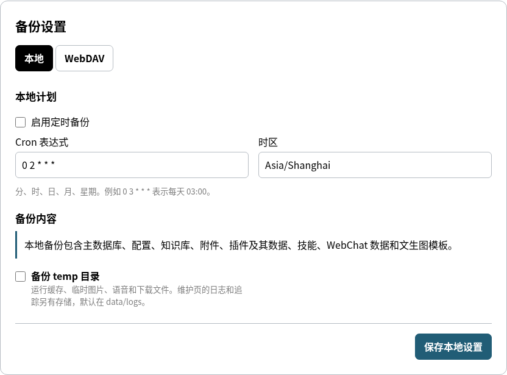
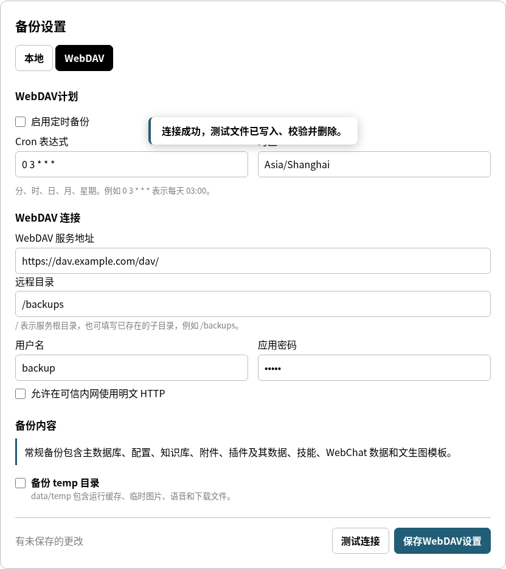

# Local and WebDAV backup contents

In **Backup dashboard → Backup settings**, choose **Local** or **WebDAV**. Enable **备份 temp 目录** to include `data/temp` in manual and scheduled backups for that destination, then save. The note below the switch lists cached files, temporary images, audio and downloads.

A notification appears at the top center of the dashboard. Success messages stay visible for five seconds and errors for eight seconds. If saving fails, you can edit the current values and try again.

Both switches start off on a new installation. Upgrades preserve each destination’s previous `temp` selection. Both destinations include all standard backup items.

The former directory URL (WebDAV 目录地址 / 现有目录地址) is now the WebDAV service URL (WebDAV 服务地址). Upgrades keep its value. Remote directory (远程目录) defaults to `/`, meaning the service root. A service URL of `https://dav.example.com/dav/` and a remote directory of `/backups` target the existing `/dav/backups/` collection.

In the WebDAV settings, select **测试连接** (Test connection), to the left of Save. The test uses the current form values to write, verify and delete a small ZIP in the target directory. Save the settings to use them for manual and scheduled backups.

If you cannot find an archive, compare the remote target shown in Recent runs with the directory you are browsing. Filter the AstrBot logs by the ZIP filename to see the HTTP status of the final ZIP upload (`PUT`) and verification (`PROPFIND`). If the log says `checking parent collection`, the plugin is looking up the exact ZIP path and size in the parent directory listing. `WebDAV verified` confirms the check. The connection test then deletes its test file. A verified run means the server reported the expected byte count at the final path. Older successful runs are labeled as unverified.

