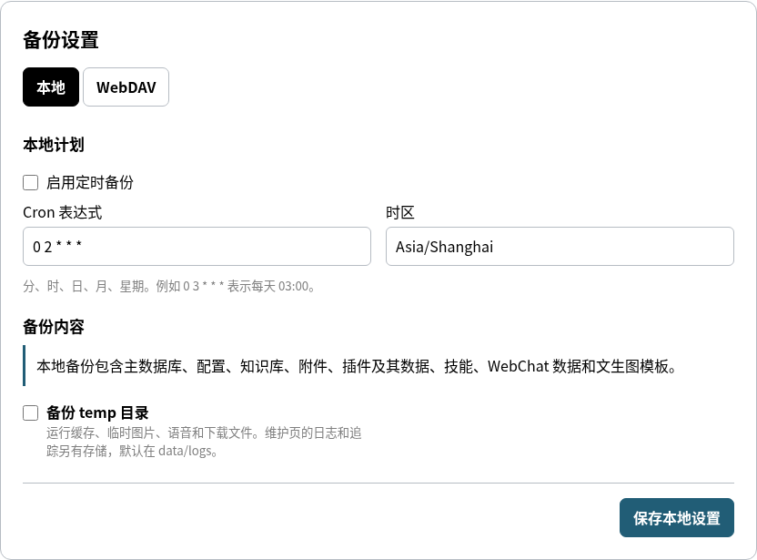
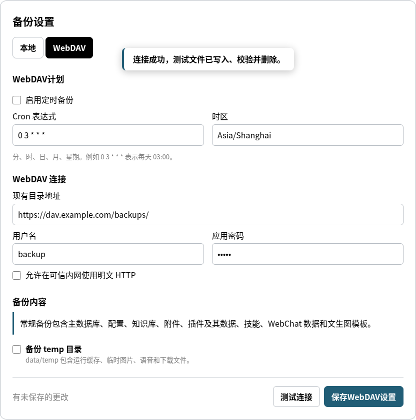

# 本地与 WebDAV 备份范围

在「备份仪表盘 → 备份设置」选择本地或 WebDAV。勾选「备份 temp 目录」并保存即可在该目标的手动和定时备份中收录 `data/temp`。开关下方的小字列出了目录中的运行缓存、临时图片、语音和下载文件。

点击保存后，仪表盘顶部中央会弹出提示。成功提示停留 5 秒，错误提示停留 8 秒。保存失败时可以修改当前输入并重试。

两个开关默认关闭。升级时，旧版「本地备份项」和「WebDAV备份项」分别沿用各自对 `temp` 的选择。其他常规项目都会备份。

在 WebDAV 设置里，点击「保存 WebDAV 设置」左侧的「测试连接」即可验证当前输入。插件会在目标目录写入一个小 ZIP，改名、校验并删除。测试通过后点击保存，让手动和定时任务使用这组设置。

如果在远端找不到备份，先核对「最近运行」里的远端目标，再按 ZIP 文件名筛选 AstrBot 日志。`PUT` 是写入，`MOVE` 是改名，`PROPFIND` 是读取最终文件属性。「成功（已校验）」表示服务器在该路径报告的字节数与本地一致。升级前的成功记录标记为「成功（旧版未校验）」。

